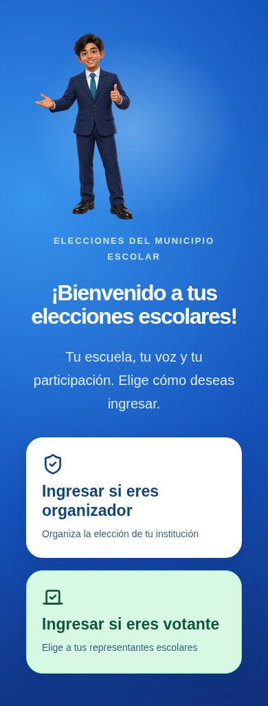
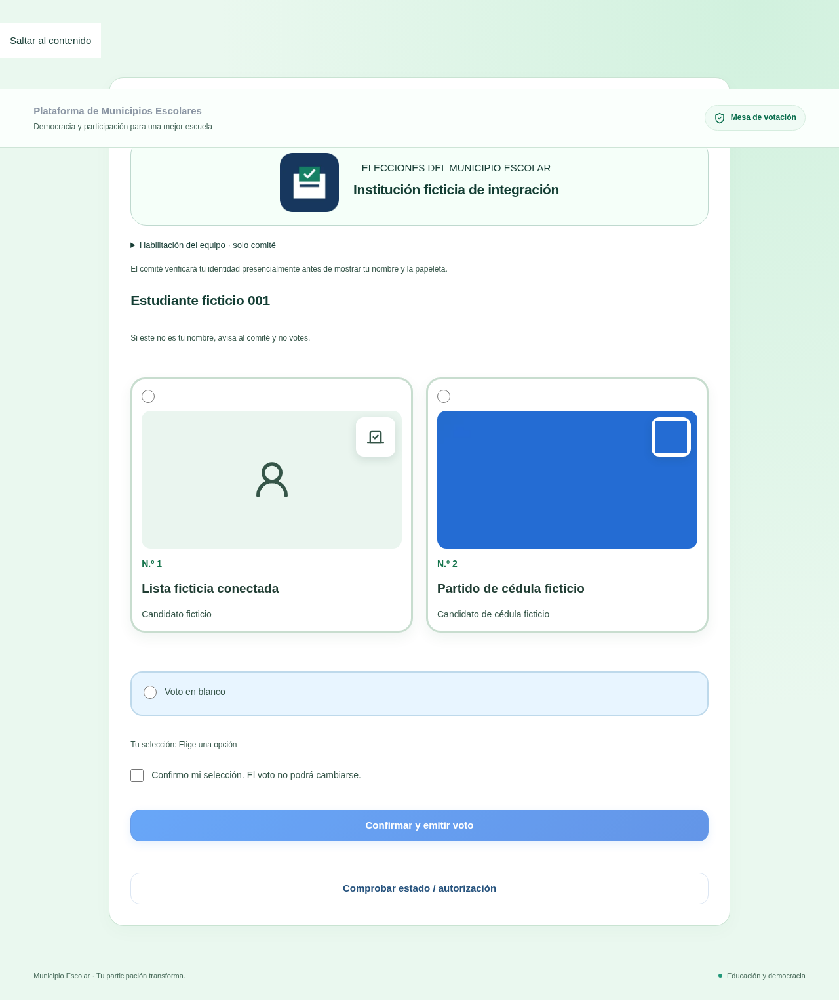

# Entrada de organizadores y votantes

Al abrir la página o la aplicación instalada aparece una portada azul con el
personaje ilustrado y solo dos accesos:

- **Ingresar si eres organizador**: abre el panel existente y solicita la cuenta
  del personal y su segundo factor cuando corresponde.
- **Ingresar si eres votante**: abre la computadora de votación, sin mostrar las
  herramientas administrativas. El estudiante se identifica por DNI, sin cuenta.

La instalación de la aplicación sigue disponible en Ayuda. Su inicio ahora es la
portada de dos accesos. El service worker no almacena ni reenvía votos.

## Preparar la elección y pasar a votación

1. Carga el padrón, registra las candidaturas y sus regidores y revisa sus datos.
2. En **Mi institución y equipo**, carga y guarda **Logo o insignia del colegio**.
   Se aceptan JPG, PNG o WebP de hasta 3 MB, con autorización institucional.
3. Abre la elección y pulsa el botón grande **Pasar a votación**.
4. Pulsa **Actualizar fotos y símbolos para votar**. Se preparan miniaturas de
   las imágenes autorizadas guardadas. Repite este paso si después cambias alguna
   fotografía o símbolo. No se modifican los candidatos, votos ni el padrón.
5. En esa misma pantalla revisa el control de apertura y habilita cada equipo.
   Registrar candidatos o preparar miniaturas no abre la elección. La apertura
   conserva sus requisitos: padrón completo, candidaturas válidas, autorización
   de seguridad y configuración de votación habilitada por el responsable.
6. En cada computadora de estudiantes utiliza un navegador o perfil sin sesión
   del organizador. Abre la portada, elige Votante e introduce una sola vez la
   habilitación privada del equipo. Nunca compartas la sesión del administrador.

El organizador permanece en su panel para verificar los documentos y autorizar
los turnos. No es necesario iniciar la cuenta administrativa en las demás mesas.

## Lo que ve el alumno

Desde la portada azul, el estudiante elige Votante e introduce su DNI en el equipo habilitado. El comité verifica la
identidad y autoriza el turno. La papeleta muestra los candidatos registrados en
cuadros con fotografía, símbolo, nombre del partido y nombre del candidato; el
encabezado muestra la insignia y el nombre del colegio. Las imágenes faltantes se
indican mediante un icono, sin inventar una fotografía.

El alumno selecciona un candidato o el voto en blanco y confirma su elección.
Solo tras registrar o comprobar su participación aparece el agradecimiento con el
personaje. No se muestra su selección en la pantalla de agradecimiento.
**Terminar y limpiar pantalla** confirma la limpieza y vuelve a la portada azul
para la siguiente atención, conservando la habilitación privada del equipo.

## Activación necesaria una sola vez

Con las migraciones 001–010 ya aplicadas, revisar y ejecutar manualmente solo
[202610230011_institution_branding_ballot.sql](../supabase/migrations/202610230011_institution_branding_ballot.sql)
en el editor SQL del mismo proyecto de Supabase. No repetir las anteriores.
Después esperar Ready/Listo en Vercel y recargar la plataforma.

No se necesitan claves nuevas ni se vuelve público el bucket de fotos. La
insignia se guarda como una miniatura WebP por institución; las imágenes de la
cédula se preparan como miniaturas WebP de hasta 256 píxeles y tamaño acotado.
Las rutas y los archivos originales permanecen en Storage privado.

La presentación de la mesa se consulta mediante su habilitación de alta entropía,
guardada en una cookie HttpOnly del servidor. La función verifica que la mesa
esté activa y vigente, que la elección esté abierta y que la modalidad oficial
esté autorizada. Solo devuelve identidad institucional y candidaturas, nunca DNI,
padrón, datos del turno, conteos o selección de voto. Las miniaturas autorizadas
viajan en esa respuesta: no se distribuyen claves administrativas ni enlaces
públicos permanentes a las fotografías originales.

Los nombres de partidos y candidatos se consultan de los registros actuales,
por lo que no se conserva una lista de nombres desactualizada en una copia de la
papeleta. La identidad electoral y los votos continúan en las funciones atómicas
existentes. La nueva migración no abre ni aprueba ninguna elección.

## Capturas de verificación local

Solo contienen datos e imágenes ficticios de verificación.

