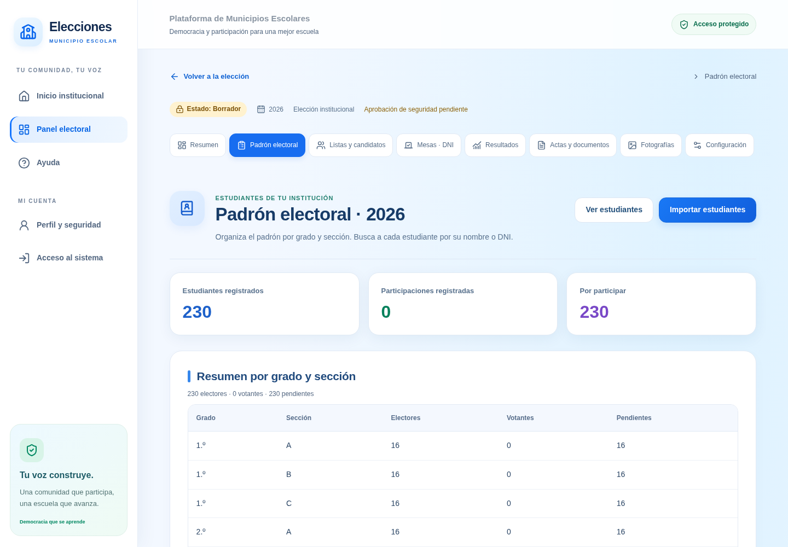
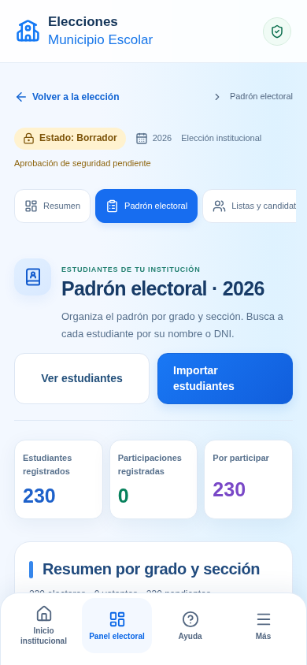

# Uso institucional y pantallas de trabajo

Las pantallas de acceso, seguridad, equipo, padrón, configuración, mesas,
imágenes y preparación comparten encabezados con iconos, botones visibles,
estados y ayudas breves. La navegación permite regresar a la elección o al
panel. En celular las pestañas muestran automáticamente la sección activa.
La preferencia de reducir movimiento se respeta también durante la carga.

## Padrón

**Ver estudiantes** lleva al directorio. Se puede buscar por nombre, apellidos o
DNI/código, combinar grado y sección y limpiar los filtros. La búsqueda ignora
mayúsculas y acentos; no modifica los registros.

**Importar estudiantes** lleva al formulario. **Descargar plantilla Excel**
genera una hoja vacía, sin datos inventados, con las columnas requeridas y la
columna DNI configurada como texto para conservar sus ocho dígitos. El archivo
se completa en Excel y se importa con el procedimiento existente. Las reglas
sobre duplicados, grado, sección y capacidad de la elección permanecen vigentes.

Las tarjetas muestran los estudiantes y participaciones que realmente devuelve
la consulta autorizada. El padrón y sus búsquedas siguen limitados al personal
de la institución, con MFA y verificación en el servidor.

## Mesas y acceso

El comité dispone de información sobre los equipos registrados y habilitados y
los turnos por verificar. Los estados se muestran con nombres claros y las
caducidades en horario de Perú. Si no hay equipos o turnos, la pantalla explica
el siguiente paso.

La computadora del estudiante debe usar un navegador o perfil sin sesión
administrativa. Si se intenta habilitar desde una sesión de administrador, el
formulario permanece visible y explica el bloqueo; no aparenta haber habilitado
la mesa. Se conservan la verificación presencial, el voto único, el secreto del
voto y la limpieza de pantalla al terminar.

## Recorrido para la jornada real

1. Completar los datos de la institución y autorizar al equipo responsable.
2. Preparar la elección institucional y configurar el total definitivo de electores.
3. Importar el padrón y revisar sus registros y cantidades.
4. Completar las listas: número electoral, propuestas, alcalde y regidores;
   cargar símbolos y fotografías autorizados desde sus formularios.
5. Preparar las computadoras y revisar el procedimiento de verificación del DNI.
6. Revisar **Preparación institucional**, coordinar la aprobación y habilitación
   con el responsable y abrir la elección cuando corresponda.
7. Durante la jornada, verificar a cada estudiante y autorizar su turno.
8. Cerrar la votación y consultar **Resultados** y **Actas y documentos**.
   En el acta se incorporan la insignia y los nombres para revisión y firma.

## Qué significa “listo”

Esta actualización mejora las pantallas de una plataforma con datos y operaciones
institucionales; no convierte borradores en elecciones abiertas ni cambia sus
aprobaciones. Los estados de preparación se consultan realmente: si la emisión,
el modo oficial o las mesas con DNI están deshabilitados en la aplicación,
aparecen pendientes. Tenerlos configurados tampoco abre una elección.

Las demostraciones siguen ocultas en producción. Se conservan sus etiquetas y
restricciones en el entorno local que las habilita explícitamente; no se cambia
el propósito de elecciones existentes ni se borran registros para ocultarlo.

Para una elección oficial siguen siendo necesarias las variables de habilitación,
la aprobación correspondiente y la apertura explícita. La guía de
[votación con DNI](VOTACION-PRESENCIAL-DNI.md) detalla esos controles. No basta
con cambiar textos o colores para autorizar votos.

## Actualización y verificación

Esta mejora no requiere SQL, migraciones ni claves nuevas. Se despliega con la
configuración existente; no modifica los padrones ni los votos alojados.
Las invitaciones de personal conservan sus requisitos de la migración 009 y
la configuración privada de Auth ya documentados.

Las pruebas añadidas verifican búsqueda y filtros, descarga y estructura real de
la plantilla XLSX, pantallas de 320 a 1440 píxeles y presentación de requisitos
pendientes. La prueba de mesa comprueba también que un bloqueo de sesión
administrativa conserve el formulario de habilitación. Todas usan datos ficticios.

## Vistas de referencia

Estas capturas se generaron con una institución y cantidades **ficticias** para
revisar la distribución. No contienen padrones reales ni describen la
configuración de una institución alojada.

Verificación completada: compilación de producción con Webpack, ESLint,
TypeScript y 86 pruebas locales (19 unitarias, 22 de PostgreSQL, 24 de
integración, 11 generales y 10 operativas). Los servicios alojados de cada
institución conservan su configuración; estos controles no certifican ni abren
una elección oficial.
