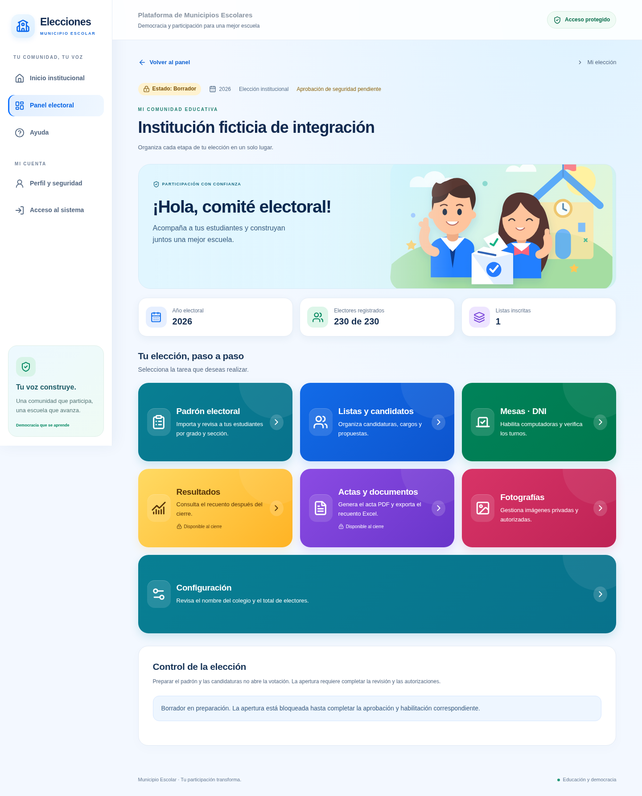
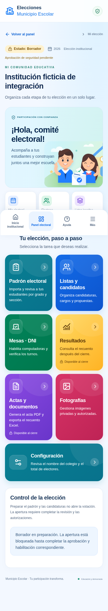

# Interfaz electoral para PC y celular

La navegación reúne las tareas de cada elección en tarjetas: padrón, listas y
candidatos, mesas con DNI, resultados, actas, fotografías y configuración.
Las credenciales individuales aparecen cuando corresponde esa modalidad. El
acceso a Mesas · DNI también permite preparar la modalidad presencial.

En el resumen se muestran las tarjetas una sola vez. Dentro de las secciones,
un menú compacto permite cambiar de tarea. El enlace **Volver a la elección**
regresa al resumen; **Volver al panel** regresa al listado de elecciones. Estos
controles tienen destinos definidos y funcionan aunque se abra una URL directa.

En PC la navegación general ocupa una barra lateral. En celular queda en la
barra inferior; **Más** permite acceder al perfil, seguridad e inicio de sesión.
El menú se puede cerrar con Escape y devuelve el foco al botón que lo abrió.
La mesa de estudiantes conserva una pantalla independiente sin enlaces al panel
administrativo.

## Aspecto y accesibilidad

Colores por tarea, ilustración escolar original, estados visibles, controles
táctiles, foco de teclado y formularios con casillas de tamaño apropiado.
Los movimientos son suaves y se desactivan con la preferencia del sistema de
reducir movimiento. Las tablas y las pestañas se desplazan dentro de su propio
contenedor en pantallas pequeñas.

Las cifras del resumen se consultan en la base de datos; si la consulta falla,
se indica que no están disponibles. No se inventan fechas, avisos ni resultados.

## Resultados y actas

Resultados muestra el recuento. Actas y documentos reúne la generación del PDF
con insignia y firmantes y la exportación Excel. Ambas rutas verifican permisos
en el servidor y exigen una elección cerrada antes de consultar resultados.
Los archivos se generan a petición del personal autorizado.

Este cambio no requiere migraciones SQL ni variables nuevas. Mantiene los
controles de sesión, MFA, pertenencia institucional y habilitación electoral.

## Vistas de referencia

Capturas generadas localmente con **institución y datos ficticios**; no incluyen
padrones reales ni credenciales. Las cifras sirven para verificar la distribución
visual y no representan el estado de ninguna institución.

### PC

### Celular

## Verificación

La suite operativa comprueba navegación de regreso, destinos sin duplicados,
anchos de 320 a 1440 píxeles, menú móvil y teclado, movimiento reducido, bloqueo
de actas antes del cierre y descarga PDF después del cierre. También comprueba
que una cuenta de elector no pueda acceder al acta administrativa.
