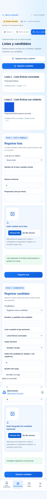

# Personal autorizado, símbolos y candidatos

## Registrar listas y candidatos

En la elección, abre **Listas y candidatos**. Los botones visibles llevan a:

1. **Registrar lista y símbolo**: nombre de la lista o partido escolar, número
   electoral, propuestas y símbolo desde el celular o la computadora.
2. **Registrar candidato**: nombres y apellidos, lista, cargo electoral, orden,
   nombre del cargo, grado y sección. Su fotografía es opcional.

El número electoral identifica a la lista en la papeleta. El orden pertenece al
candidato dentro de esa lista: 0 para alcalde y 1–20 para regidores. El selector
de cargo propone el orden inicial. Se conservan las validaciones electorales.

El símbolo pertenece a la lista y aparece en su ficha y en la papeleta existente.
La fotografía pertenece al candidato. Las imágenes se previsualizan antes de
registrar y se vinculan automáticamente al guardar. No se escriben rutas.
Se aceptan JPG, PNG y WebP de hasta 5 MB, con confirmación de autorización.
El servidor comprueba el contenido, elimina metadatos y guarda WebP en Storage
privado utilizando la sesión del personal. Solo se edita en borrador.

## Invitar al equipo sin UUID

Un administrador con MFA abre **Mi institución y equipo**, completa nombre,
correo y rol y pulsa **Generar invitación personal**. Puede elegir comité o
administrador institucional. El comité no puede invitar ni gestionar permisos.

La plataforma muestra un enlace privado para copiar y entregar personalmente.
**No envía correos ni mensajes automáticamente.** Quien recibe el enlace crea su
contraseña, inicia sesión y configura MFA. La institución y el rol quedan
asignados por el administrador; el invitado no puede elegirlos.

El enlace es de un solo uso y vence según Email OTP Expiration de Supabase Auth.
La credencial viaja en el fragmento del enlace (después de `#`), se retira de la
barra del navegador y no se coloca en parámetros de consulta. Abrir la página
no consume la invitación: la persona debe enviar el formulario de activación.
No se almacena el enlace en el padrón, registros de auditoría ni almacenamiento
local del navegador. No incluir enlaces privados en capturas o repositorios.

El equipo muestra correos, roles, estado de activación y controles de revocación
con confirmación. Revocar el acceso impide posteriores operaciones aunque la
persona conserve su sesión Auth. No se borra su cuenta ni su actividad previa.
Las cuentas existentes se asignan por correo desde la sección avanzada. Una
cuenta asignada a otro colegio no puede trasladarse por este medio.

Si un enlace ya se utilizó, la persona debe iniciar sesión o recuperar su
contraseña. Si vence antes de la activación, el administrador pulsa **Generar nuevo enlace**
en la ficha de la invitación pendiente. El nuevo enlace sustituye al anterior;
no se generan cuentas duplicadas ni se publica una contraseña compartida. Si se creó la cuenta Auth pero falló la
asignación institucional, no se entrega ningún enlace y la cuenta queda sin
acceso electoral; el operador debe revisarla. No se eliminan cuentas como
compensación automática porque podrían existir operaciones simultáneas.

## Configuración de producción — solo una vez

Los formularios de candidatos y sus imágenes usan las migraciones y el Storage
ya existentes. **Las invitaciones y la vista de equipo necesitan:**

1. Revisar y aplicar manualmente **solo**
   [202610220009_staff_invitations.sql](../supabase/migrations/202610220009_staff_invitations.sql)
   después de 008 en el editor SQL de Supabase. No volver a ejecutar 001–008.
   Esta migración añade funciones de directorio, autorización con límites y
   asignación por correo. No cambia votos, padrones ni apertura electoral.
2. En Supabase, Project Settings → API Keys, obtener una clave privada de tipo
   `sb_secret_...`. Guardarla exclusivamente en Vercel como
   **SUPABASE_AUTH_ADMIN_KEY**, para los despliegues autorizados, y redesplegar.
   No usar `NEXT_PUBLIC_`, no enviarla por chat y no sustituir
   SUPABASE_PUBLISHABLE_KEY. La clave concede privilegios importantes: limitar
   su acceso al servidor, utilizar una clave dedicada y rotarla si se expone.
3. Mantener Email/Password habilitado en Auth y el registro público desactivado.
   Revisar Email OTP Expiration y los requisitos de contraseña. La generación
   administrativa de la invitación permite dar de alta al personal sin abrir
   registro público. El enlace utiliza APP_ORIGIN; comprobar que sea el dominio
   real de la plataforma. No requiere cambiar las plantillas de recuperación.
4. Probar con dos cuentas de personal autorizadas, aceptar una invitación,
   verificar MFA y comprobar la revocación antes de incorporar al equipo real.

El cliente privilegiado está aislado en un módulo `server-only` y solo devuelve
la API administrativa de Auth. No se utiliza para consultar elecciones, Storage
ni RPC electorales. La autorización de invitaciones ocurre en PostgreSQL con la
sesión del administrador, AAL2 y pertenencia al colegio. Hay límites compartidos
de 20 solicitudes por hora por colegio y 200 globales, incluyendo intentos que
lleguen a autorizarse aunque luego falle el proveedor. Las cuentas existentes
no reciben una nueva contraseña ni un enlace de activación desde este flujo.

## Validación local

Las pruebas nuevas cubren la migración 009 con PostgreSQL desechable: MFA,
comité sin permisos administrativos, aislamiento entre colegios, asignación por
correo, revocación y solicitudes concurrentes bajo el límite compartido.
Las pruebas operativas usan un proveedor Auth local ficticio para el flujo de
invitación de un solo uso y para la subida/vinculación de símbolos y fotos.
La comprobación del proveedor alojado sigue siendo un paso de configuración de
producción; nunca se utilizan cuentas reales durante estas pruebas.

Validación completada: 84 pruebas (19 unitarias, 22 PostgreSQL local, 24 de
integración, 11 generales y 8 operativas), ESLint, TypeScript y compilación de
producción con Webpack. En este entorno Turbopack no pudo abrir su proceso
auxiliar; no se cambió el compilador predeterminado del proyecto.

Captura del formulario móvil con **datos completamente ficticios**:

